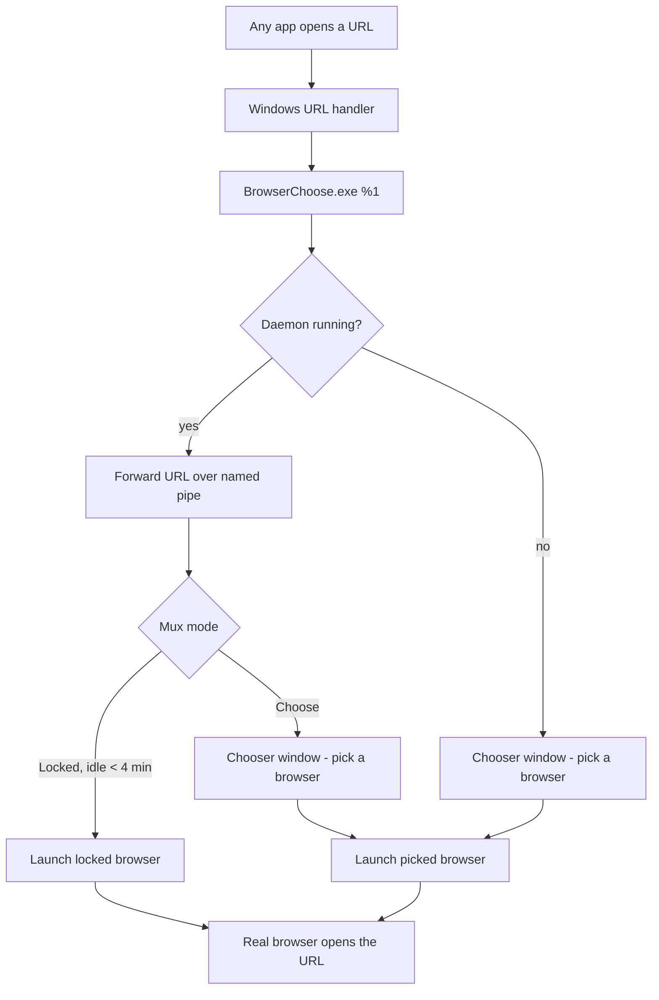

# BrowserChoose

**A URL-handler multiplexer for Windows.** BrowserChoose installs itself as the
handler for the `http`, `https` (and `ftp`) protocols, then decides — for every
link that is opened — which browser or program should actually receive it.

Instead of being stuck with a single fixed default browser, you get a small
systray app plus a pick-a-browser dialog that can route each URL on the fly.

## The gist

Windows has exactly one "default browser" per protocol and no built-in way to
send a *particular* link somewhere else. BrowserChoose takes over that single
slot and turns it into a switchboard:



The trick is to never hand the OS a real browser. The OS is pointed at
BrowserChoose, and BrowserChoose proxies the launch. That proxy step is what
makes per-browser arguments, profiles, and even non-browser targets (such as
`wget` or a shell script) possible.

## Repository layout

| Path | Purpose |
| --- | --- |
| `systraymain/` | Entry point (`main.go`). Calls `browserchoose.Run(os.Args)`. |
| `chooser.go` | Config loading and `Run`: the dispatcher for daemon, URL-handler and `-register` modes. |
| `tray.go` | Fyne system-tray menu (Choose, browser list, Open config, Quit) and URL routing. |
| `mux.go` | Session-only browser lock with the 4-minute idle timeout. |
| `guichooser.go` | The pick-a-browser window (`Chooser`, `NewChooser`, `RunChooser`). |
| `ipc_windows.go` / `ipc_other.go` | Named-pipe forwarding from handler invocations to the running daemon. |
| `register_windows.go` / `register_other.go` | Per-user (HKCU) URL-handler registration. |
| `datamodel.go` | `BrowserItem` / `BrowserList` types and the viper → model parser. |
| `launch.go` | Starts a browser with its args, and opens the config file. |
| `signals.go` | Ctrl-C / SIGTERM handling. |
| `guimain/` | Standalone runner for the chooser window (development aid). |
| `icon/` | Embedded app icon (`icon.go`). `WebIcon.ico` is built from `WebIcon.png` by `icon/makeico`. |
| `docs/` | Notes, including [`uri-handler-registration.md`](docs/uri-handler-registration.md). |

## Configuration

Settings live in `browser_choose_config.yaml`. It is searched for, in order, in
`%APPDATA%\browserchoose.zvodd.github.com\`, next to `BrowserChoose.exe`, and in
the working directory. Don't rely on the working directory: when Windows launches
the URL handler it can be anywhere. The tray's **Open config** item opens the file that was loaded.

```yaml
selected: "0"          # index of the browser highlighted by default
browsers:
  "0":                 # keys must be positive decimal integers; order = menu order
    name: "Firefox"
    icon: ""           # optional; a path to an image shown on the chooser button
    path: "${PROGRAMFILES(X86)}/Mozilla Firefox/firefox.exe"
    args:
      - "-new-tab"
      - "@URL"         # "@URL" is replaced with the URL being opened
  "1":
    name: "Chrome"
    icon: ""
    path: "${PROGRAMFILES}/Google/Chrome/Application/chrome.exe"
    args:
      - "@URL"
```

Field notes:

- `selected` — index into the ordered `browsers` list (stored as a string).
  Read into the model, but not yet used.
- `browsers` — keyed by integer-as-string; keys are sorted numerically to give
  a stable menu order.
- `path` — executable to launch. Environment variables are expanded with
  `os.ExpandEnv`; use `${NAME}` for names containing punctuation, e.g.
  `${PROGRAMFILES(X86)}` (`$NAME(x86)` would *not* expand correctly).
- `args` — argument list passed to the executable. Each entry is a separate
  argument, so `-profile` and its value go on two lines. The literal token
  `@URL` is substituted with the URL being handled.
- `icon` — optional image shown on the chooser button. Leave empty for a
  text-only button.

## Systray behaviour

The tray menu presents:

- **Choose** *(default)* — the chooser dialog pops up for every URL. This is
  the out-of-the-box mode and is **not** persisted.
- **Browser list** — clicking a browser *locks* the mux to it, so URLs go
  straight there without a dialog. The lock is:
  - **session-only**: it lives in memory, is never written to the config, and
    does not survive a restart;
  - **idle-limited**: it reverts to **Choose** after 4 minutes with no URL
    routed through it. Each routed URL restarts the 4-minute countdown.
- **Open config** — opens `browser_choose_config.yaml` in the default editor.
- **Quit**.

## The chooser window

In *Choose* mode the app shows a window with the URL that is being opened and a
row of browser buttons (with icons, when `icon` resolves). Clicking one launches
that browser with the URL and closes the window. Picking a browser from the
window does **not** change the tray lock.

## Running it

BrowserChoose is one binary with a few modes:

| Command | What it does |
| --- | --- |
| `BrowserChoose.exe` | Runs the tray daemon. Leave it running. |
| `BrowserChoose.exe <url>` | Handles one URL (this is what Windows calls). Forwards it to the daemon if one is running; otherwise shows the chooser on its own. |
| `BrowserChoose.exe -register` | Registers BrowserChoose as an http/https/ftp handler for the current user and opens **Default apps**. |
| `BrowserChoose.exe -unregister` | Removes the registration. |

Typical setup: run `BrowserChoose.exe -register`, select BrowserChoose for
`http`/`https` in the Default apps window, then start `BrowserChoose.exe` (add it
to your startup folder if you want it always on).

## Troubleshooting

The GUI build has no console, so diagnostics go to
`%APPDATA%\browserchoose.zvodd.github.com\browserchoose.log`. Each URL handled,
forwarded, or launched is logged there, and fatal errors also show a dialog.

## URL-handler registration

Registration writes per-user keys under `HKCU` (no administrator rights needed):

- `HKCU\Software\Classes\BrowserChooseURL` — the ProgID, with
  `shell\open\command` = `"<path>\BrowserChoose.exe" "%1"`.
- `HKCU\Software\BrowserChoose\Capabilities` — app name, plus `URLAssociations`
  for `http`, `https` and `ftp`.
- `HKCU\Software\RegisteredApplications` — makes the app appear in Default apps.

Windows 8 and later do not allow an app to set its own default browser, so
`-register` opens `ms-settings:defaultapps` and the user confirms the choice.
The full research, including the restrictions and the older Windows versions,
is in [`docs/uri-handler-registration.md`](docs/uri-handler-registration.md).

## Current status

Implemented, but not yet verified by a real Windows build (see below):

- Config loading via viper, including `icon`, `path` and `args`.
- Single-process daemon: the Fyne tray and the chooser share one event loop.
- Tray menu with Choose, the browser lock, Open config, and Quit.
- Session-only browser lock with a 4-minute idle timeout (`mux.go`, covered by
  unit tests).
- URL forwarding from handler invocations to the daemon over a named pipe. A
  second daemon fails to claim the pipe and exits.
- `-register` / `-unregister` for per-user handler registration.
- Clean shutdown from the tray's Quit item or Ctrl-C / SIGTERM.

Still to do:

- **Build-verify on Windows.** The Fyne packages need cgo, and this environment
  has no C compiler. Build with a mingw-w64 `gcc` on `PATH`.
- **Run it end to end.** Register, pick a browser in Default apps, click a link
  in a real app, and check the chooser, the lock, and the timeout.
- **Use the `selected` setting** to pre-highlight the default browser.
- **Tests beyond the mux.** The config parser, the chooser, and the tray have
  none yet.

## Building

Requires Go 1.26 or newer (see the `go` directive in `go.mod`). The chooser and
tray use Fyne, which needs cgo and a C compiler on Windows (mingw-w64 `gcc`)
with `CGO_ENABLED=1`.

```sh
# tray daemon / URL handler (no console window)
go build -ldflags "-H windowsgui" -o BrowserChoose.exe ./systraymain

# standalone chooser for development
go build -o guimain.exe ./guimain
```

The icon is embedded in the binary: the tray and window icons come from
`icon/WebIcon.ico`, and the `.exe` file icon comes from
`systraymain/rsrc_windows_amd64.syso`. After changing `icon/WebIcon.png`,
regenerate both:

```sh
go run ./icon/makeico
go run github.com/akavel/rsrc@latest -ico icon/WebIcon.ico -o systraymain/rsrc_windows_amd64.syso
```

Run the standalone chooser without registering anything:

```sh
go run ./guimain https://example.com
```

Build artifacts (`*.exe`) are git-ignored; run the build commands rather than
committing binaries.

## Credits / references

- Registry/URL-handler approach adapted from
  [jopeek/browserchooser](https://github.com/jopeek/browserchooser).
- GUI and system tray via [Fyne](https://fyne.io/).
- Named-pipe transport via [go-winio](https://github.com/microsoft/go-winio).
- Config via [spf13/viper](https://github.com/spf13/viper).
