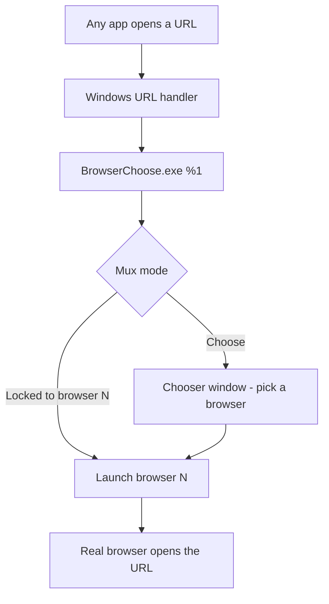

# BrowserChoose

**A URL-handler multiplexer for Windows.** BrowserChoose installs itself as the
handler for the `http`, `https` (and `ftp`) protocols, then decides — for every
link that is opened — which browser or program should actually receive it.

Instead of being stuck with a single fixed default browser, you get a small
systray app plus a pick-a-browser dialog that can route each URL on the fly.

## The gist

Windows has exactly one "default browser" per protocol and no built-in way to
send a *particular* link somewhere else. BrowserChoose takes over that single
slot and turns it into a switchboard:



The trick is to never
hand the OS a real browser. The OS is pointed at BrowserChoose, and
BrowserChoose proxies the launch. That proxy step is what makes per-browser
arguments, profiles, and even non-browser targets (such as `wget` or a shell
script) possible.

## Repository layout

| Path | Purpose |
| --- | --- |
| `systraymain/` | Entry point (`main.go`) for the systray binary. Calls `browserchoose.Main()`. |
| `chooser.go` | Root package: config loading, systray menu construction, click dispatch. |
| `datamodel.go` | `BrowserItem` / `BrowserList` types and the viper → model parser. |
| `signals.go` | OS signal handling and internal quit signalling. |
| `gui/` | Fyne chooser window: `Chooser` type and `RunChooser` helper. |
| `guimain/` | Entry point (`main.go`) that runs the chooser window on its own. |
| `setdefaultbrowser/` | Registry work: registering BrowserChoose as the URL handler. |
| `icon/` | Systray icon (`icon_win.go` is generated from `WebIcon.png`). |
| `docs/` | Notes, including [`uri-handler-registration.md`](docs/uri-handler-registration.md). |

## Configuration

Settings live in `browser_choose_config.yaml`. Viper searches for it in
`$APPDATA/browserchoose.zvodd.github.com/` and then in the working directory
(portable mode). The systray "Open config" action should open this same file.

```yaml
selected: "0"          # index of the browser highlighted by default
browsers:
  "0":                 # keys must be positive decimal integers; order = menu order
    name: "Firefox"
    icon: "./firefox.png"
    path: "${PROGRAMFILES(X86)}/Mozilla Firefox/firefox.exe"
    args:
      - "-profile 1"
      - "@URL"         # "@URL" is replaced with the URL being opened
  "1":
    name: "Chrome"
    icon: "./chrome.png"
    path: "..."
    args:
      - "@URL"
```

Field notes:

- `selected` — index into the ordered `browsers` list (stored as a string).
  Read into the model, but not yet used by the chooser.
- `browsers` — keyed by integer-as-string; keys are sorted numerically to give
  a stable menu order.
- `path` — executable to launch. Shell-style environment variables are expanded
  with `os.ExpandEnv`; use `${NAME}` for names containing punctuation, e.g.
  `${PROGRAMFILES(X86)}` (`$NAME(x86)` would *not* expand correctly).
- `args` — argument list passed to the executable. The literal token `@URL` is
  substituted with the URL being handled.
- `icon` — path to the icon shown on the chooser button.

## Systray behaviour

The tray menu presents:

- **Choose** *(default)* — the mux pops the chooser dialog on every URL. This
  is the out-of-the-box mode and is **not** persisted.
- **Browser list** — clicking a browser *locks* the mux to it, so URLs are sent
  straight there without a dialog. Locking is **session-only**: it is never
  written to the config and does not survive a restart. A locked choice may
  also **time out** and fall back to *Choose* (not implemented yet).
- **Open config** — opens `browser_choose_config.yaml` in the default editor.
- **Quit**.

## The chooser window

In *Choose* mode the app shows a window with the URL that is being opened and a
row of browser buttons (with icons, when `icon` resolves). Clicking one launches
that browser with the URL and closes the window.

The window lives in the `gui` package (`gui.Chooser`, `gui.RunChooser`) and can
be run on its own via the `guimain` command:

```sh
go run ./guimain https://example.com
```

## URL-handler registration

Registering BrowserChoose as the `http`/`https`/`ftp` handler is Windows
registry work. The research extracted from the reference implementation — the
exact keys, the Windows 8+ restrictions, and the elevation flow — is documented
in [`docs/uri-handler-registration.md`](docs/uri-handler-registration.md).

## Current status

Working today:

- Reads and validates `browser_choose_config.yaml` via viper, including `icon`,
  `path` and `args`.
- Systray menu: **Choose** (default), the browser list (session-only lock),
  **Open config**, and **Quit**.
- The chooser window (`gui`/`guimain`) shows the URL and a button per browser,
  and launches the picked browser with the URL and configured args.
- Quits cleanly on the tray "Quit" item or an OS `SIGINT`/`SIGTERM`.

Still to do:

- Integrate the systray and the Fyne GUI into a single process (the GUI and the
  tray each want the main thread / event loop, so this needs care).
- Register BrowserChoose as the URL handler (see the registration doc) and feed
  the incoming URL (`os.Args[1]`) into the mux.
- Wire the tray's Choose/lock mode into the actual launch path, including the
  optional lock timeout.

## Building and running

Requires Go 1.26 or newer (see the `go` directive in `go.mod`). The systray and
model packages build anywhere, but the chooser GUI uses Fyne and therefore needs
cgo and a C compiler (mingw-w64 `gcc` on Windows) with `CGO_ENABLED=1`.

```sh
# systray binary
go build ./systraymain

# chooser window binary (needs cgo)
go build ./guimain
```

Run the chooser on its own (no systray, no URL-handler registration needed):

```sh
go run ./guimain https://example.com
```

`*.exe` build artifacts are git-ignored; run the build commands rather than
committing binaries.

## Credits / references

- Registry/URL-handler approach adapted from
  [jopeek/browserchooser](https://github.com/jopeek/browserchooser).
- Systray via [getlantern/systray](https://github.com/getlantern/systray).
- GUI via [Fyne](https://fyne.io/).
- Config via [spf13/viper](https://github.com/spf13/viper).
